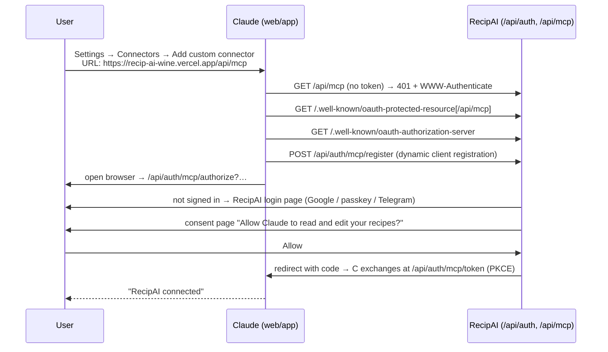

# Spec: RecipAI connector for Claude & ChatGPT

**Status:** v1 released (v2.31.0). Round 2 (below) on the branch. Directory listings postponed.
**Branch:** `claude/vigilant-babbage-c7ja2l` (feature branch, never `main`)

This spec is written so that any agent or developer can pick the work up from
here. Progress is tracked in the [checklist](#checklist) at the bottom. Tick boxes
as commits land.

---

## 1. Goal

Signed-in RecipAI users can connect RecipAI to **Claude** (first) and **ChatGPT**
(second) as a connector. Inside those chat apps they then have the same access
to **their own** recipes as in the app: search, read, create, update and
delete. The app gets an entry point on the recipe detail page ("Ask AI" →
Claude / ChatGPT).

A separate, smaller item in the same branch: recipes that arrive from the server
(Telegram bot, another device, the connector) should no longer appear silently.
Show a small "Updating recipes…" indicator and fade new cards in.

### Non-goals (v1)

- Anonymous or local-only users. A connector needs an account.
- Real-time push to open devices. The existing pull triggers stay (login,
  foreground, pull-to-refresh). Connector writes show up on the next pull.
- Uploading image binaries through the connector. An optional `imageUrl` is fine.
- Directory listing in the ChatGPT or Claude stores. v1 is a custom connector
  added by URL.

---

## 2. How it works for the user

A connector is a **remote MCP server**: an HTTPS endpoint (`/api/mcp`) that
exposes tools. It is protected by **OAuth 2.1**, with RecipAI acting as the
authorization server.

**The RecipAI app cannot install the connector into Claude.** The user adds it
once from Claude's side. The OAuth sign-in happens during that one-time step,
started by Claude, not by a button in RecipAI.

### 2.1 One-time setup (per user, per chat app)



The connector is then available in every Claude chat, on web and in the mobile
apps (connectors added on the web carry over to the apps).

### 2.2 Per-recipe "Ask AI" (entry point in the RecipAI app)

1. The user taps **Ask AI** on a recipe detail page and picks **Claude** (or
   **ChatGPT**, phase 4) from the popover.
2. If the user **has connected** RecipAI to that app (the server knows, see
   §5.3), RecipAI opens
   `https://claude.ai/new?q=<url-encoded prompt>`, where the prompt is something like
   *"Use RecipAI to open my recipe "Borscht" (id `abc123`) and help me with it."*
   Claude calls `fetch` and the conversation starts with the recipe in context.
3. If the user **has not connected** yet, a bottom sheet explains the one-time
   setup (§2.1). It has a "Copy connector URL" button and an "Open Claude
   settings" link. After connecting, the user taps **Ask AI** again.

> ⚠️ **To verify:** the `?q=` prefill on `claude.ai/new` is not officially
> documented and has reportedly changed behaviour before. Fallback: copy the
> prompt to the clipboard, open `https://claude.ai/new`, and show a toast
> saying "Prompt copied, paste it in Claude". Check the same for ChatGPT
> (`https://chatgpt.com/?q=`).

### 2.3 Recipe detail buttons (decided)

The page has **Start cooking** (full-width, primary) and **Open post / Source**
(full-width, secondary). Layout:

```
[            Start cooking             ]   ← unchanged
[  Open post  ] [ 🪄 Ask AI ]               ← two half-width buttons
```

- **Ask AI** uses a magic-wand icon (lucide `WandSparkles`), not the official
  Claude or ChatGPT logos. Using those logos would need a review of each
  company's brand guidelines, so v1 avoids them.
- Tapping it opens a small tooltip-style popover with two text options:
  **Claude** and **ChatGPT**. Until phase 4 lands, only Claude is listed.
- When there is no `sourceUrl`, **Ask AI** takes the full row.
- Shown only for signed-in users.

---

## 3. Architecture

### 3.1 What already exists and is reused

| Piece | Where | Reuse |
|---|---|---|
| Auth | `lib/auth/auth.ts` (better-auth 1.6.33, Drizzle adapter) | Add the `mcp` plugin |
| Owner-scoped recipe CRUD | `app/api/recipes/route.ts`, `app/api/recipes/[id]/route.ts` | Extract into `lib/recipes/` service, shared by REST and MCP |
| Write whitelist | `app/api/recipes/recipe-write-fields.ts` (`pickRecipeContent`) | Reused by the service |
| Server-side save | `lib/parse-recipe/save-parsed-recipe-server.ts`, `parsed-recipe-shape.ts` (`buildSavedRecipeShape`) | `create_recipe` builds the stored shape the same way |
| Parse queue | `app/api/parse-queue/*` | `import_recipe` enqueues a normal parse job for the user |
| Ingredient normalisation | Client-side, `normalizePendingRecipes` / `normalizePulledRecipes` | **Nothing new.** Server-written recipes are normalised on the device after pull, as already happens for Telegram-bot saves |
| Sync | `hooks/use-sync-on-login.ts`, `lib/db/reconcile-plan.ts` (server wins) | Connector writes reach devices on the next pull |
| Rate limiting | `lib/rate-limit.ts` (Redis) | Per-user limits on MCP tools |
| Pages outside the locale tree | `app/external-auth/*` (own layout plus `intl-provider`, excluded in `proxy.ts` matcher) | Host the OAuth login and consent pages here |

### 3.2 better-auth `mcp` plugin (in the installed 1.6.33)

Verified against the published `better-auth@1.6.33` package:

- `import { mcp } from "better-auth/plugins"`, with options
  `{ loginPage: string; resource?: string; oidcConfig?: OIDCOptions }`.
  Inside `oidcConfig`: `consentPage`, `scopes`, `requirePKCE`,
  `accessTokenExpiresIn` (default 3600 s), `refreshTokenExpiresIn` (default
  604800 s; **RecipAI uses 30 days**),
  `allowPlainCodeChallengeMethod` (default false, S256 only).
- Endpoints (under `/api/auth`): `/.well-known/oauth-authorization-server`,
  `/.well-known/oauth-protected-resource`, `/mcp/authorize`, `/mcp/token`,
  `/mcp/register` (dynamic client registration), `/oauth2/consent`,
  `/mcp/get-session`.
- Next.js helpers exported from the same module: `withMcpAuth(auth, handler)`
  (returns 401 with `WWW-Authenticate: Bearer resource_metadata=…` when there is
  no or a bad token), `oAuthDiscoveryMetadata(auth)`, and
  `oAuthProtectedResourceMetadata(auth)`.
- New DB models: `oauthApplication`, `oauthAccessToken`, `oauthConsent`, which
  need a Drizzle migration.
- Default scopes are `openid profile email offline_access`. Refresh tokens are
  issued only when `offline_access` is granted.
- **Deprecation:** `mcp` wraps `oidcProvider`, which upstream is deprecating in
  favour of `@better-auth/oauth-provider` (a `release-1.6` line exists on npm).
  Use the built-in `mcp` plugin for v1: no new dependency, and it matches the
  pinned version. Migrating is a follow-up, recorded in `docs/explanation/decisions.md`.

### 3.3 New routes and files

```
app/.well-known/oauth-authorization-server/[[...path]]/route.ts  → RFC 8414 metadata (lib/mcp/metadata.ts)
app/.well-known/oauth-protected-resource/[[...path]]/route.ts    → RFC 9728 metadata
app/api/mcp/route.ts                     → MCP Streamable HTTP endpoint (stateless, JSON), bearer auth in lib/mcp/auth.ts
app/api/mcp/connections/route.ts         → GET connected AI apps / DELETE { clientIds } to revoke
app/external-auth/oauth/login/page.tsx   → loginPage for the mcp plugin
app/external-auth/oauth/consent/page.tsx → consentPage
lib/auth/mcp-consent.ts                  → forceMcpConsent + rejectUnconsentedCode (hooks.before)
lib/mcp/{config,metadata,auth,context,server,clients,connections}.ts
lib/mcp/tools/*.ts                       → read-recipes, write-recipes, import-recipes, collections, chatgpt-compat
lib/recipes/{queries,mutations,collections,input,view}.ts → owner-scoped data access for the tools
lib/parse-recipe/{parse-cache,server-import}.ts → import_recipe through the parse queue
lib/ai-apps.ts, lib/hooks/use-ai-connections.ts, components/ask-ai/*, profile ai-assistants card
db/schema/auth.ts (+ migration 0026)     → oauth_application, oauth_access_token, oauth_consent
```

Notes:

- The catch-all `[[...path]]` on both `.well-known` routes is needed because
  MCP clients try the **path-suffixed** form first
  (`/.well-known/oauth-protected-resource/api/mcp`,
  `/.well-known/oauth-authorization-server/api/auth`) and then the root.
- `proxy.ts` matcher `"/((?!…|.*\\..*).*)"` already skips any path containing
  a dot, so `/.well-known/*` is **not** touched by next-intl or the maintenance
  gate. `/api/mcp` **does** go through the maintenance gate, which is fine and
  returns 503 during maintenance.
- `app/external-auth/*` is already excluded from the i18n middleware and has its
  own intl provider, so the OAuth pages work there without locale prefixes.
- MCP transport: use **stateless** Streamable HTTP (no session ids), so it works
  the same on Vercel serverless and on the Pi. Add `@modelcontextprotocol/sdk`
  as a direct dependency, pinned to an exact version as the repo does. Prefer
  the SDK's Web-standard (Fetch `Request`/`Response`) Streamable HTTP transport
  if the pinned version has one. Otherwise use `mcp-handler`, which adapts the
  SDK to Next.js route handlers. Decide at implementation time and record it in
  `decisions.md`.
- `resource` in the plugin config = `${NEXT_PUBLIC_BETTER_AUTH_URL}/api/mcp`.

### 3.4 Login resume (risk to verify early)

When `/mcp/authorize` finds no session, it redirects to `loginPage` with the
original query string, and the plugin's after-sign-in hook is supposed to resume
the authorize flow. RecipAI's logins are **redirect-based** (Google, Telegram
OIDC) or **WebAuthn** (passkey). Verify that the resume works for each one. If the
hook does not fire after a social redirect, the login page should pass
`callbackURL = /api/auth/mcp/authorize?<original query>` to `signIn.social`,
and navigate there itself after a passkey or Telegram success.

### 3.5 Tools

All tools run as the token's `userId`. Every query filters on
`recipes.userId = userId`. Inputs are validated with zod. Outputs are compact JSON
text plus a short human summary. They are localised with the user's locale when
known, otherwise English.

| Tool | Phase | Input | Behaviour |
|---|---|---|---|
| `list_recipes` (merged into `search` in the directory-listing round) | 1 | `{ query?, category?, collectionId?, limit≤50, cursor? }` | Title / description / ingredient-text match. Returns `id, title, category, servings, totalTime, updatedAt` |
| `get_recipe` (merged into `fetch`) | 1 | `{ id }` | Full recipe: ingredients (with sections), steps, times, source URL, collections, public share URL if public |
| `create_recipe` | 2 | `{ title, description?, servings?, prepTime?, cookTime?, category?, ingredients[{item, amount?, unit?, section?}], instructions[{instruction, section?}], sourceUrl?, imageUrl? }` | Uses `buildSavedRecipeShape`. `id = crypto.randomUUID()`, `isPublic=false`. Normalisation happens on the device after pull |
| `delete_recipe` | 2 | `{ id }` | Owner-scoped hard delete, same as the app's delete. `destructiveHint: true`, so clients ask the user to confirm. Devices drop it on the next pull (the `syncedAt` marker rule) |
| `update_recipe` | 2 | `{ id, …partial of the create fields }` | Owner-scoped. Replacing `ingredients` or `instructions` rebuilds the shape. Bumps `updatedAt`, clears `canonicalIngredientIds` when ingredients change (so the device re-normalises). Returns `not_found` when no row matched |
| `import_recipe` | 2 | `{ url }` | Enqueues a parse job for the user (same path as an in-app link import, including dedupe by source). Returns the job id and status. A `get_import_status` tool or polling via `get_recipe` follows |
| `list_collections` | 2 | `{}` | `id, name, emoji, count` |
| `add_to_collection` | 2 | `{ recipeId, collectionId }` | Updates `collectionIds` |

ChatGPT compatibility (phase 4): ChatGPT's connector and deep-research modes
look for two read-only tools with fixed shapes. `search({ query })` returns
`{ results: [{ id, title, url }] }`, and `fetch({ id })` returns
`{ id, title, text, url, metadata }`. Both are thin wrappers over
`list_recipes` and `get_recipe`. `url` is the recipe's page in the app.

Tool annotations: read tools `readOnlyHint: true`. Write tools
`destructiveHint: false`, except `delete_recipe`, which is `destructiveHint: true`.
`idempotentHint` where true.

### 3.6 Security

- Tokens are scoped to one user. Tools never take a `userId` argument.
- PKCE S256 is required. Plain is off. The consent page names the client
  (`oauthApplication.name`) and says what it grants.
- Rate limits (Redis, per user): reads 120/min, writes 30/min, `import_recipe`
  10/hour (it costs AI and scraping money). These numbers are tunable.
- Payload caps: reuse `lib/api-limits.ts`, for example max ingredients and
  steps, and max string lengths.
- Revoke: phase 3 adds "Connected AI apps → Disconnect" in Profile, which deletes
  that client's `oauthAccessToken` rows for the user.
- **Consent is always shown.** The plugin skips consent unless the client sends
  `prompt=consent`. Because dynamic client registration is open to anyone, a
  silent grant would let any registered client obtain a token for a signed-in
  user who opened a crafted link. A `hooks.before` on `/mcp/authorize` forces
  `prompt=consent`.
- Telemetry: a `mcp_tool_called` event (tool name, client name, success). Never
  log recipe content or tokens. Report errors to Sentry as the other routes do.
- Recipe text returned to the model is the user's own data. Imported pages could
  contain prompt-injection text. That is acceptable, because tools only touch
  the user's own recipes and there is no delete.

---

## 4. Testing locally

### 4.1 MCP Inspector (no tunnel, fastest loop)

```bash
bun run dev
```

```bash
npx @modelcontextprotocol/inspector
```

In the Inspector: transport **Streamable HTTP**, URL
`http://localhost:3000/api/mcp`, then **Connect**. It runs the full OAuth flow in
your browser against localhost (sign in, consent), then lists the tools and lets
you call them.

### 4.2 Real Claude (needs a public HTTPS URL)

Claude connects from Anthropic's servers, so `localhost` will not work. Use a tunnel
with a **stable** hostname. An ngrok free static domain or a named Cloudflare
tunnel both work.

```bash
ngrok http --url=<your-static-domain>.ngrok-free.app 3000
```

Then:

1. Set `NEXT_PUBLIC_BETTER_AUTH_URL=https://<domain>` in `.env.local` and restart
   `bun run dev`. In development, `getAllowedAuthHosts` already adds the
   configured host.
2. Sign-in on the tunnel origin: add
   `https://<domain>/api/auth/callback/google` to the Google OAuth client's
   authorized redirect URIs. Passkeys are bound to their domain, so a passkey
   made on localhost will not work on the tunnel domain. Use Google.
3. In Claude: Settings → Connectors → Add custom connector →
   `https://<domain>/api/mcp`, then Connect, sign in and allow.
4. In a new chat, ask "List my RecipAI recipes".

Alternative to the tunnel: a Vercel preview deployment (`*.vercel.app` is
already an allowed dev host). Same Google redirect-URI caveat.

Production connector URL: `https://recip-ai-wine.vercel.app/api/mcp`. Vercel
is the only host; the Pi is abandoned.

### 4.3 Database

The migration only **adds** tables. `local dev → shared Supabase` is safe, but apply
it once with `DATABASE_URL="$SUPABASE_MIGRATION_URL" bun run db:migrate` before
running the branch, as `docs/how-to/deploy-vercel.md` describes.

### 4.4 Automated

Vitest unit tests for `lib/recipes/service.ts` (owner scoping, not-found,
validation) and each tool handler (mock the service). Also a route test for
`/api/mcp` returning 401 with `WWW-Authenticate` when there is no token. Run
`bun run test --run`, `bun run typecheck` and `bun run check:ci` before each push.

---

## 5. Phases & commits

Small, reviewable commits. Conventional Commit messages (commitlint is enforced).
Each phase ends in a state the owner can pull and test.

### Phase 0: spec
- `docs(spec): plan RecipAI AI connector` (this file plus mkdocs nav)

### Phase 1: Claude, read-only, testable end to end ✅
1. `feat(auth): add better-auth mcp plugin and oauth tables`
2. `feat(auth): oauth sign-in and consent pages for connectors`
3. `feat(auth): serve oauth discovery metadata under /.well-known`. Built
   in `lib/mcp/metadata.ts`, because the plugin's helper fails with a
   dynamic `baseURL`.
4. `fix(auth): refuse to exchange connector codes before consent`. Found
   by the end-to-end run: the plugin's token endpoint redeemed the
   pending consent code.
5. `feat(mcp): add /api/mcp with list_recipes and get_recipe`. The REST
   routes were **not** refactored: changing their behaviour (for example
   a 404 on PATCH) would add Sentry noise from device sync. The connector
   has its own `lib/recipes/` module instead.
6. `docs(mcp): how to connect and test the connector`

### Phase 2: write tools ✅
7. `feat(mcp): create, update and delete recipe tools`, with per-user rate
   limits (120 reads, 30 writes per minute) and telemetry in
   `instrumentTool`
8. `feat(mcp): import_recipe via the parse queue`, plus `get_import_status`
9. `feat(mcp): collection tools`: list, create, add and remove

### Phase 3: in-app entry point ✅
10. `feat(mcp): connections endpoint for status and revoke`
11. `feat(recipe-detail): add an Ask AI button with connector setup sheet`
12. `feat(profile): add an AI assistants card with connect and disconnect`

### Phase 4: ChatGPT ✅
13. `feat(mcp): add ChatGPT-compatible search and fetch tools`
14. `feat(recipe-detail): add ChatGPT to the Ask AI menu`

Verified locally: an end-to-end script ran the whole OAuth flow and every
tool against Postgres, on both the dev server and a production build (47
checks), including isolation between users and revoke. **Not** verified:
connecting from the real Claude and ChatGPT apps. That needs a public URL
(see `docs/how-to/test-ai-connector.md`).

### Phase 5: periodic pull — dropped
The owner decided against a timer-based re-pull. The existing triggers stay:
sign-in, returning to the app, and pull-to-refresh.

### Phase 6: sync message ✅ (simplified)
15. `chore: remove the recipai.pp.ua domain and the Pi deploy step`
16. `feat(recipes): show a message while recipes sync in the background`.
    A tinted pill says "Updating recipes…" while a sync runs past 300 ms,
    then "N new recipes" when it brought in recipes the device didn't have.
    No new sync logic, and no card fade-in (the owner asked for a message
    only).

---

### Round 2: after the owner's first test (v2.31.0)
19. `fix(layout): keep top bars clear of the iOS status bar`. A shared
    `--top-gap` (inset + 12px) for every top bar and the sync pill. The
    pull-to-refresh label sits at the bottom of a 44px strip.
20. `fix(ask-ai): open Claude's connector setup in the native app`. The link
    is `claude.ai/customize/connectors?modal=add-custom-connector`, which is
    in claude.ai's universal links. The old `/settings/connectors` link
    opened an in-app browser with no accounts.
21. `feat(mcp): let the chat parse recipes, with our import for social posts`.

| Source in the chat | How it's saved |
|---|---|
| Pasted text, photo or screenshot | The chat parses it and calls `create_recipe` |
| Web page | The chat reads it and calls `create_recipe`. `import_recipe` only if it can't open the page |
| Instagram, TikTok, YouTube, X | `import_recipe` (RecipAI transcribes the video) |
| Failed import | The result carries a hint to fall back to `create_recipe` |

Source links are stored without tracking parameters. Steps accept image
URLs. `update_recipe` can set or remove the main photo, and photo problems
come back as `warnings`.

Found while testing: the Sally's Baking link fails in the app's own import
too ("no recipe found"). That's the app's parser and site blocking, not the
connector; left as is.

### Later: directory listings (postponed by the owner)
What listing gets you: one-tap connect from inside Claude and ChatGPT, on
mobile too. ChatGPT drops the web/desktop developer-mode step. You also
get a directory page you can link from the app.

**Both platforms: code and pages still missing**
- [ ] Public privacy policy page (for example `/privacy`): what's
      collected, how it's used and kept, and how to delete it. A missing
      one means immediate rejection on Claude.
- [ ] Public docs page: setup, usage, and three working example prompts.
- [ ] Support contact (email).
- [ ] Reviewer test account with sample recipes and no MFA. RecipAI has
      only Google, passkey and Telegram sign-in, so either a dedicated
      Google test account or a hidden email-and-password login for one
      review account.
- [ ] Refresh-token rotation: delete the old token row on refresh. The
      plugin leaves it valid.
- [ ] Annotations: Claude wants `destructiveHint: true` on every tool that
      modifies data (today only delete). Claude will then likely confirm
      writes with the user.

**Claude (Connectors Directory)**
- Plan: Pro, Max, Ultra, Team or Enterprise. Portal:
  `claude.ai/directory/manage` → Submit new → MCP connector.
- Listing: name, one-liner, description, categories, icon, docs URL,
  privacy URL, support contact, use cases, slug (permanent), company
  details, test credentials and instructions, seven policy
  acknowledgments.
- Review: automatic scan → listed as **Community**. Possibly escalated to
  **Verified** (a reviewer runs every tool). Timing isn't fixed.
- Afterwards: keep it working, report material changes (tool changes need
  a reviewed listing edit). Share `claude.ai/directory/connectors/<slug>`
  from a "Connect to Claude" button in the app.

**ChatGPT (Apps directory)**
- OpenAI Platform organization verification (identity), Owner role, a
  project with global data residency. Submitted in the Platform dashboard.
- Domain verification token at `/.well-known/openai-apps-challenge`, and
  a CSP declared on the MCP server.
- Metadata, country availability, privacy policy, usage policies, content
  suitable for all audiences.
- Test account, test cases and at least 3 screenshots. The counts are from
  third-party write-ups, so check the dashboard.
- Manual review, one version at a time. Unconfirmed: whether a tools-only
  app with no custom UI is accepted.

### In-app chat: not possible on a subscription
The owner wants chats on their own Claude or ChatGPT plan, not an API key.
- Claude: Anthropic's policy forbids third-party apps from using claude.ai
  login or plan limits unless Anthropic approved them.
- ChatGPT: "Sign in with ChatGPT" (plan allowance in other apps) is a
  limited preview for invited partners.

The connector stays the way to use the subscriptions. Revisit if OpenAI
opens Sign in with ChatGPT.

---

## 6. Decisions (answered by the owner)

1. **Both apps.** Claude first, ChatGPT in phase 4. The UI is built for both from the start.
2. **Icons:** a wand icon plus a popover with text options. No official logos.
3. **Host:** Vercel only, at `https://recip-ai-wine.vercel.app`. The Pi is abandoned (the docs are updated).
4. **Refresh token lifetime:** 30 days.
5. **Periodic pull:** dropped; a visible sync message instead.
6. **Full access:** connector tools cover search, read, create, update and delete of the user's own recipes.
7. **Testing:** self-tested end to end; the owner tests on production after release. The migration was applied by the owner before the merge.

---

## Checklist

- [x] Phase 0: spec
- [x] Phase 1: OAuth + read-only MCP (Claude testable)
- [x] Phase 2: write tools
- [x] Phase 3: in-app entry point
- [x] Phase 4: ChatGPT
- [x] Phase 5: periodic pull (dropped)
- [x] Phase 6: sync message
- [x] Round 2: status-bar spacing, native-app setup link, chat-first parsing
- [ ] Later: directory listings (checklist above)

## Notes for a handoff agent

- `.claude/settings.json` has hooks that ask for `graphify query` before
  grep or read. `graphify` is **not installed** in cloud containers, so fall back to
  normal search.
- `node_modules` is not installed in a fresh container. Run `bun install` first.
- Never push to `main`. Work only on the branch named at the top.
